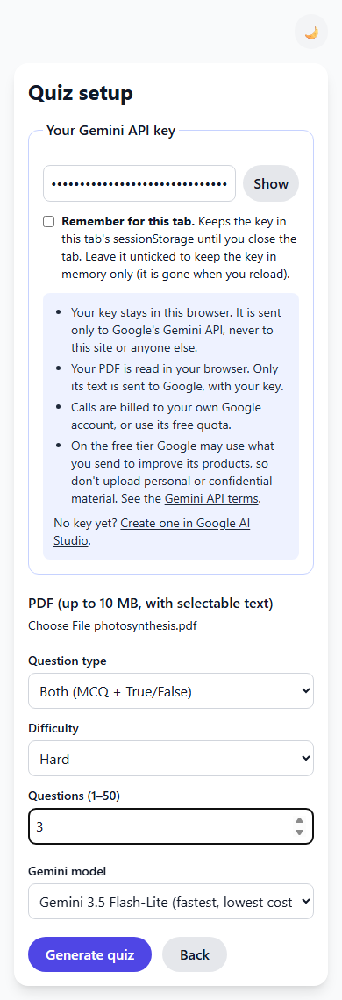
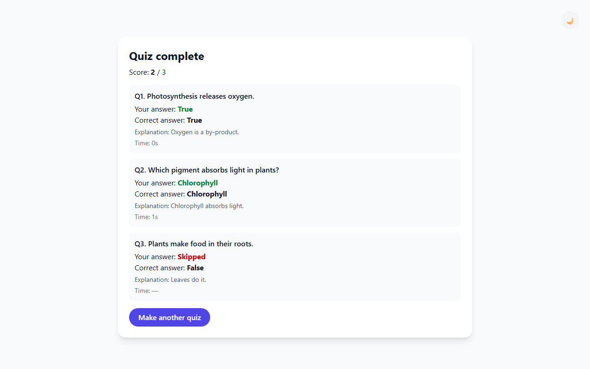
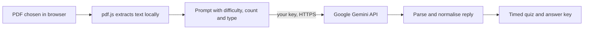

# PDF to Quiz: turn a PDF into a quiz with your own Gemini key

[](https://creativecommons.org/licenses/by-nc-nd/4.0/)

## Overview

PDF to Quiz is a small web app that reads a PDF in your browser and asks Google Gemini to write multiple-choice and true/false questions from its text. You take the quiz with a per-question timer and get a score and an answer key. It has no server: you paste your own Gemini API key, and the key and the PDF never touch any server of mine.

I use it to show generative-AI-assisted assessment in the courses I teach.

## Demo

There is no hosted demo yet. Run it locally (see Getting started). The screenshots show the interface; the results screenshot was produced in a test with a **mocked** Gemini reply, not a real model.

| Setup screen (390 px) | Answer key (1280 px, mocked reply) |
|---|---|
|  |  |

## Problem statement

Teachers and students often want quick practice questions from a chapter or a set of notes. Writing them by hand is slow, and tools that upload your files to someone else's server raise privacy and cost questions. This app keeps the PDF in the browser and makes you the only party who holds the API key.

## Approach



- **Client only.** Next.js with `output: 'export'` produces static files in `out/`. There is no API route.
- **Text extraction.** `pdfjs-dist` runs in the browser. Scanned (image-only) PDFs have no text and are rejected with a clear message.
- **Generation.** The official Google Gen AI SDK (`@google/genai`) calls Gemini from the browser and asks for JSON that matches a schema.
- **Normalisation (`lib/quiz.mjs`).** A pure module turns the reply into questions with `options[]` and a 0-based `answer` index. It accepts numeric answers, letters and option text for multiple choice, and `0`/`1`, `true`/`false`, `yes`/`no` and similar for true/false (`0` means True). Questions that cannot be resolved are dropped rather than scored wrongly.
- **Limits.** 1 to 50 questions; PDF up to 10 MB; extracted text is capped at 60,000 characters (longer PDFs use their first part, and the app says so).

## Data

No dataset. Your PDF is read in the browser and only its extracted text is sent to Google, together with your key. Nothing is stored by this app.

## Privacy and the bring-your-own-key model

- **Your key stays in the browser.** It is held in memory only and is gone when you reload. An optional checkbox, "Remember for this tab", keeps it in `sessionStorage`, which the browser clears when the tab closes. The key is never written to `localStorage`, cookies or the URL, is never logged, and is sent only to Google's Gemini API (`generativelanguage.googleapis.com`) as a request header.
- **Calls are billed to your Google account** (or use its free quota). The repo owner pays nothing and sees nothing.
- **Free-tier terms.** Under Google's [Gemini API terms](https://ai.google.dev/gemini-api/terms) (read 2026-10-13), content sent through the unpaid tier may be used by Google to improve its products and may be read by human reviewers; the paid tier is not used that way. Do not upload personal or confidential material on the free tier, and check the current terms yourself.
- **Shared computers.** Do not tick "Remember for this tab" on a computer you do not control, and revoke keys you no longer need in Google AI Studio.
- **Scope of the claim.** This describes what this app's code does. Browser extensions or other scripts on a page can read what is on that page, so host it yourself if that matters to you.

## Results

No model-quality metrics are claimed. What was verified:

| Check | Result | Status | How measured | Date |
|---|---|---|---|---|
| Unit tests (answer parsing, limits, prompt, key redaction) | 100 pass, 0 fail | Verified (re-run 2026-10-13) | `npm test`, mocked Gemini replies only | 2026-10-13 |
| End-to-end: upload PDF, generate, take quiz, check answer key at 390 px and 1280 px | 6 of 6 pass | Verified (re-run 2026-10-13) | `npm run test:e2e`, Gemini request intercepted and mocked | 2026-10-13 |
| `npm audit --omit=dev` | 0 vulnerabilities (was 18: 1 critical, 13 high) | Verified (re-run 2026-10-13) | `npm audit` | 2026-10-13 |
| Question quality from real Gemini | Not measured | Not re-run (real API not called in testing) | n/a | n/a |

Logs: [docs/runs/2026-10-13-verification.md](docs/runs/2026-10-13-verification.md).

## Tech stack

Next.js 16.4.0 (static export), React 19.3.0, Tailwind CSS 4.3.3, Framer Motion 14.2.0, `pdfjs-dist` 6.4.299, `@google/genai` 2.29.0, `node --test` and Playwright 1.64.0 for tests.

## Getting started

Prerequisites: Node.js 22.13 or newer and npm, plus a Gemini API key from [Google AI Studio](https://aistudio.google.com/apikey).

```bash
git clone https://github.com/Janeferdinant/pdf-2-quiz.git
cd pdf-2-quiz
npm ci
npm run build   # static export into out/
npm run serve   # serves out/ at http://127.0.0.1:4173
```

Open http://127.0.0.1:4173, press Start, paste your key, choose a PDF and generate. For development use `npm run dev`.

Tests (no real Gemini calls):

```bash
npm test                      # 100 unit tests
npx playwright install chromium
npm run test:e2e              # needs a prior npm run build
```

Expected: `# pass 100`, `# fail 0`, and `6 passed`.

## Project structure

```
pages/index.js        Page and quiz flow
components/           ApiKeyPanel, QuizCard, ResultScreen, ThemeToggle
lib/quiz.mjs          Pure logic: limits, prompt, parsing and normalisation
lib/gemini.mjs        Browser call to Gemini and friendly error messages
lib/pdf.mjs           pdf.js text extraction
lib/keyStore.mjs      Optional sessionStorage for the key
tests/unit/           node --test, mocked replies
tests/e2e/            Playwright on the static export, Gemini mocked
legacy/api/           Old server route, unused (see below)
docs/runs/            Verification logs
```

`legacy/api/generate-quiz.js` is the version 1 server route. It is not built or imported and its dependencies are no longer installed; it is kept only until deletion is approved.

## Real-world applications

Quick practice questions from lecture notes or chapters, self-study revision, and a first draft for a teacher's question bank.

## Limitations

- AI-generated questions can be wrong or ambiguous. A teacher must review them before any graded use.
- Scanned or image-only PDFs, and text inside images, are not supported. Password-protected PDFs are rejected.
- Very long PDFs are truncated to their first 60,000 characters.
- You need a Gemini API key, and quality depends on the model you pick. Model ids were checked against Google's model list on 2026-10-13 and may change.
- PDF text is treated as material, not instructions, but prompt injection inside a PDF can still skew a quiz. It only affects your own key and your own quiz.
- Not tested against the live Gemini API in this repository.

## Future scope

A "try a sample" button with a clearly labelled pre-generated quiz, export of a quiz to JSON, and an answer-review mode.

## Credits & citation

Built with [Next.js](https://nextjs.org/), [pdf.js](https://github.com/mozilla/pdf.js), the [Google Gen AI SDK](https://github.com/googleapis/js-genai), [Tailwind CSS](https://tailwindcss.com/) and [Framer Motion](https://motion.dev/), each under its own license (see THIRD_PARTY_NOTICES.md). Questions are generated by Google Gemini.

## License

Original work © Jane Rose Ferdinant, licensed CC BY-NC-ND 4.0. Third-party components retain their own licenses; see THIRD_PARTY_NOTICES.md.

## Author

Jane Rose Ferdinant: [Portfolio](https://janeferdinant.vercel.app) · [LinkedIn](https://www.linkedin.com/in/janerosenf/)
